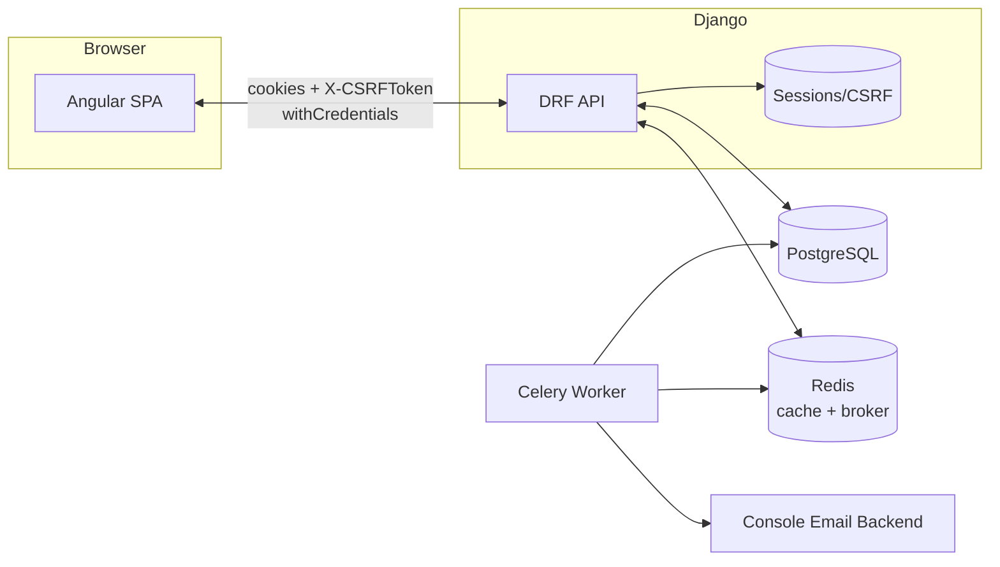
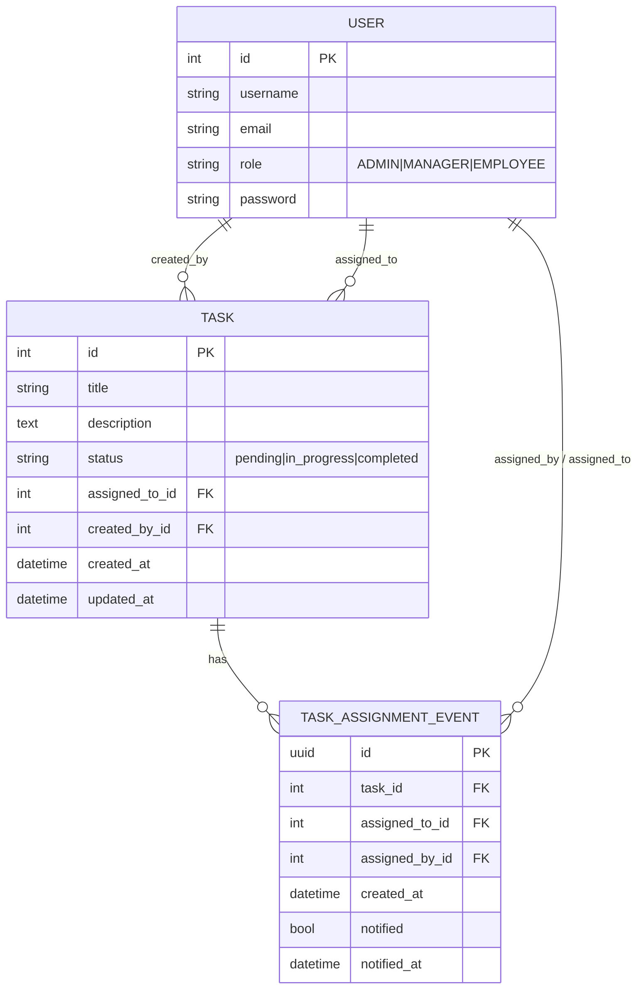
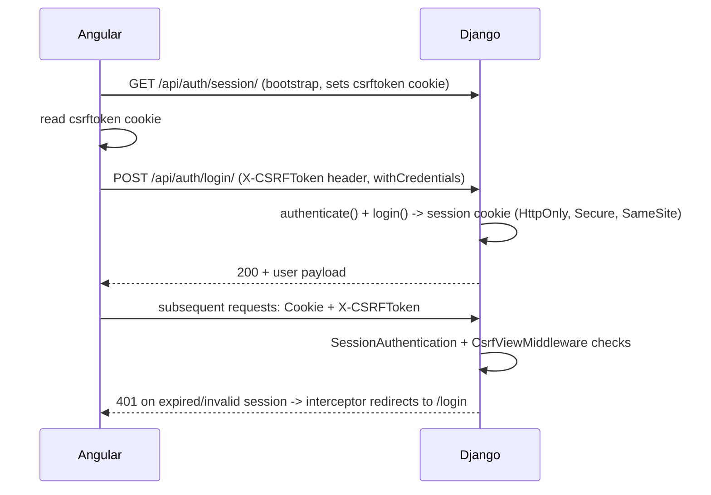
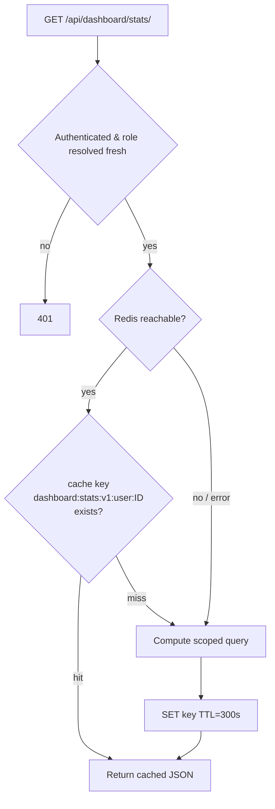

# TaskHub — Architecture

Target architecture for a clean-build Django/DRF + Angular implementation. Traces to `docs/REQUIREMENTS.md` (req IDs in brackets).

## 1. System overview



Two origins in dev (`localhost:4200` Angular, `localhost:8000` Django) → CORS with explicit origin + credentials, `CSRF_TRUSTED_ORIGINS` set [AUTH-A2].

## 2. Backend architecture (Django apps)

| App | Responsibility |
|---|---|
| `accounts` | Custom `User` model (`role` field: `ADMIN`/`MANAGER`/`EMPLOYEE`), auth views (login/logout/me/session), user list/create views. |
| `tasks` | `Task` model, CRUD, `assign` action, `TaskAssignmentEvent` model, DRF permission classes, serializers. |
| `dashboard` | `GET /api/dashboard/stats/` view + cache service layer. |
| `notifications` | Celery task(s) for assignment emails, idempotency logic. |
| `core` (optional, only if shared code emerges) | Common exception handling, pagination, base permission mixins. |

**Why a `role` field instead of Groups:** the brief allows "Django Groups/Permissions or a well-documented alternative." A single `role` CharField on `User` is simpler to query, test, and reason about for exactly 3 fixed roles — Groups add indirection with no benefit here. Documented deviation, not silent.

**Permission classes (`tasks/permissions.py`):**
- `IsAdmin`, `IsAdminOrManager` — role checks.
- `IsTaskVisible` (object-level `has_object_permission`): Admin/Manager → True always; Employee → `task.assigned_to_id == request.user.id`. Used for GET, PATCH and DELETE alike — it's both the IDOR guard on reads and the write-access guard, with *which* fields are writable on PATCH additionally restricted by serializer selection (`TaskStatusUpdateSerializer` for an Employee vs. full `TaskSerializer` for Admin/Manager) [RBAC-A1].
- `CanDeleteTask`: Admin only.
- `CanCreateOrAssignTask`: Admin/Manager only.

Every view combines `IsAuthenticated` + the relevant class(es); list endpoints additionally filter the queryset by role (never rely on serialization-time hiding).

## 3. Data model (PostgreSQL)



`TASK_ASSIGNMENT_EVENT` is the idempotency anchor: one row per assignment action (create-with-assignee, or `assign/` call). Celery task is invoked with the event's UUID; a unique DB flag (`notified`) flipped inside the task under a `select_for_update` guard ensures a retried/duplicate delivery of the *same* event never double-sends, while a brand-new event (including reassigning to the same user later) is a new row → eligible to notify [CELERY-08/09/10].

## 4. Authentication & CSRF flow [AUTH-01…13]



- `SESSION_COOKIE_HTTPONLY=True`, `CSRF_COOKIE_HTTPONLY=False` (Angular must read it), `SESSION_COOKIE_SAMESITE=Lax`, `CSRF_COOKIE_SAMESITE=Lax` for same-site dev; `Secure=True` when `DEBUG=False`/HTTPS.
- `CORS_ALLOWED_ORIGINS=["http://localhost:4200"]`, `CORS_ALLOW_CREDENTIALS=True`, no wildcard [SEC-03].
- Backend is authoritative: every private view requires `IsAuthenticated`; Angular guards are UX only [RBAC-12].

## 5. Task assignment → notification flow [CELERY-01…09]

```mermaid
sequenceDiagram
    participant A as Angular
    participant V as DRF View
    participant DB as PostgreSQL
    participant Q as Redis (broker)
    participant W as Celery Worker
    A->>V: POST /api/tasks/{id}/assign/ {assigned_to}
    V->>DB: BEGIN; update Task.assigned_to; create TaskAssignmentEvent(notified=False); COMMIT
    V->>V: transaction.on_commit(lambda: send_assignment_email.delay(event_id))
    V-->>A: 202 {"detail": "Notification queued"}
    DB-->>Q: (after commit) task enqueued
    Q->>W: deliver
    W->>DB: SELECT ... FOR UPDATE event WHERE id=event_id AND notified=False
    alt not yet notified
        W->>W: send email (console backend)
        W->>DB: UPDATE event SET notified=True, notified_at=now()
    else already notified (retry of same event)
        W->>W: no-op, log "duplicate suppressed"
    end
```

Enqueue happens strictly inside `transaction.on_commit` so a rolled-back assignment never queues a notification [CELERY-03/04].

## 6. Dashboard caching flow [CACHE-01…07]



- Cache key always includes `user.id` (not just role) → no cross-user leakage even within the same role [CACHE-05].
- Authorization/role is re-resolved from the live DB user object on every request *before* the cache lookup — a cache hit never bypasses a live permission check, so a revoked/changed role takes effect immediately [CACHE-06].
- Invalidation (`cache.delete`) triggered from the `tasks` app's service layer right after create/update/assign/delete commit — not from signals, to keep the write path explicit and testable. Every mutation invalidates: the acting user's key, the directly-affected assignee's key (previous + new on reassignment), and — because every Admin/Manager has their *own* per-user cache key caching the same "all tasks" aggregate (CACHE-05 means there's no single shared aggregate key to invalidate once) — every Admin/Manager's key, via `invalidate_for_admins_and_managers()` [CACHE-04]. An earlier version of this service only invalidated the directly-affected users, which left *other*, uninvolved Admins/Managers viewing stale totals for up to the TTL; this is now covered by a regression test (`test_task_mutation_invalidates_every_admin_and_managers_cache`).
- Redis exceptions caught at the cache-service boundary → fallback path `F` (direct scoped DB query), never a 500, never stale/wrong-scope data [CACHE-07].

## 7. Repository structure

```
taskhub-app/
├── backend/                 # Django project
│   ├── config/               # settings (base/dev/prod split via env), urls, celery.py
│   ├── accounts/              # User model, auth views, user mgmt views
│   ├── tasks/                  # Task, TaskAssignmentEvent, views, permissions, serializers
│   ├── dashboard/               # stats view + cache service
│   ├── notifications/             # celery tasks
│   ├── manage.py
│   └── requirements.txt
├── frontend/                 # Angular project
│   └── src/app/
│       ├── core/               # interceptors, guards, models, base api service
│       ├── auth/
│       ├── dashboard/
│       ├── tasks/
│       └── users/
├── docs/                     # this doc set (confidential subset gitignored)
├── docker-compose.yml         # postgres, redis, backend, celery worker, frontend
├── .env.example
├── plan.md
├── CLAUDE.md
└── README.md
```

Simple two-folder monorepo — no Nx/Lerna tooling, no shared-package layer. Justified by project size (one backend, one frontend, no shared runtime code).

## 8. Key technical decisions & trade-offs

| Decision | Alternative considered | Why this way |
|---|---|---|
| `role` field on User vs Django Groups | Groups+Permissions framework | Fewer moving parts for exactly 3 fixed roles; explicitly allowed by brief as "well-documented alternative" |
| Explicit `cache.delete` on mutation vs signals | `post_save`/`post_delete` signals | Keeps invalidation visible at the call site, easier to test and reason about; avoids signal-ordering surprises |
| `TaskAssignmentEvent` table vs idempotency via cache/lock only | Redis `SETNX` lock on `(task_id, assigned_to)` | Survives Redis restarts, auditable, and naturally expresses "new event = new row" without extra bookkeeping |
| Two-folder monorepo vs Nx workspace | Nx-managed monorepo | Nx is overkill for one backend + one frontend; adds setup time against an 8–12h budget for no benefit |
| Status-only edit for assignee enforced in serializer | Enforced only in permission class | A permission class answers yes/no for the whole request; field-level restriction needs serializer-level logic regardless, so that's where the rule actually lives |
